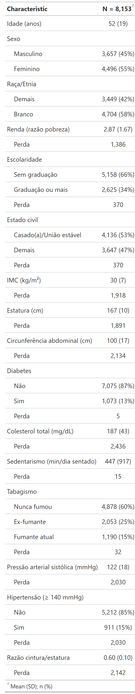

# Epidemiologia Computacional e Inteligência Artificial

Material complementar da aula "**Epidemiologia Computacional e Inteligência Artificial**", ministrada por [Daniel Fatori](https://scholar.google.com.br/citations?user=xIM4B1gAAAAJ&hl=pt-BR&hl=pt-BR) no contexto da **Prova didática do Concurso Público** para provimento de Professor Doutor no Departamento de Medicina Preventiva da Faculdade de Medicina da Universidade de São Paulo.

Este repositório contém análises didáticas de **aprendizado de máquina** aplicadas aos dados epidemiológicos do estudo **NHANES (anos 2021–2023)**.

---


## Objetivo do repositório

Apresentar conceitos básicos de aprendizado de máquina aplicados a área da epidemiologia. Os scripts e dados estão organizados de forma a permitir que o aluno possa baixar o conjunto completo de arquivos disponíveis do repositório e reproduzir as análises.

## Objetivo da análise

Desenvolver um modelo preditivo de **hipertensão arterial sistêmica** (pressão sistólica ≥ 140 mmHg) a partir de variáveis sociodemográficas e clínicas utilizando dados do estudo epidemiológicos NHANES de 2021-2023.

---

## Dados

Dados baixados pelo pacote [`nhanesA`](https://cran.r-project.org/package=nhanesA) (NHANES, ciclo L — 2021–2023) e salvos localmente em `data/`.

| Tabela NHANES | Conteúdo |
|---|---|
| `DEMO_L` | Idade, sexo, raça/etnia, renda |
| `BMX_L` | Antropometria: cintura e estatura (para calcular razão cintura/estatura) |
| `BPXO_L` | Pressão arterial oscilométrica (média das 3 medidas) — PAS ≥ 140 mmHg = **desfecho** |
| `DIQ_L` | Diabetes diagnosticada |
| `TCHOL_L` | Colesterol total sérico |
| `SMQ_L` | Tabagismo (SMQ020 + SMQ040 → 3 categorias) |
| `PAQ_L` | Atividade física: sedentarismo (min/dia sentado) |

### Tabela descritiva dos dados



---

## Estrutura do Repositório

```
.
├── scripts/
│   ├── rodar.R                     # Executa o pipeline baseline (00–04)
│   ├── 00_config.R                 # Download, limpeza e preparo dos dados
│   ├── 01_regressao.R              # Regressão Logística
│   ├── 02_random_forest.R          # Árvore de Decisão + Random Forest
│   ├── 03_gradient_boosting.R      # Gradient Boosting (gbm / XGBoost)
│   ├── 04_rede_neural.R            # Rede Neural (MLP: nnet + brulee)
│   ├── exercicio.R                 # Fora da sequência: banco ampliado (~20 preditores)
├── data/                           # Dados NHANES em cache (.rds)
└── output/                         # Tabelas e gráficos
```

---

## Fluxo de trabalho

| # | Script | Modelo | Desfecho |
|---|---|---|---|
| 00 | `00_config.R` | — | Download e limpeza dos dados |
| 01 | `01_regressao.R` | Regressão Logística | HAS (PAS ≥ 140 mmHg) |
| 02 | `02_random_forest.R` | Árvore de Decisão + Random Forest | HAS (PAS ≥ 140 mmHg) |
| 03 | `03_gradient_boosting.R` | Gradient Boosting (stumps iterativos) | HAS (PAS ≥ 140 mmHg) |
| 04 | `04_rede_neural.R` | Rede Neural MLP (`nnet` + `brulee`) | HAS (PAS ≥ 140 mmHg) |

Pipeline completo (baseline, scripts numerados 00–04) a partir da raiz do projeto:

```r
source("scripts/rodar.R")
```

## Exercício para alunos

`exercicio.R` expande o banco para ~20 preditores. Rode-o compare o desempenho dos modelos.

---

## Conteúdo didático de cada script

- **`01` — Regressão Logística**: função logística, log-odds, odds ratio, curva ROC.
- **`02` — Árvore + Random Forest**: critério de Gini, overfitting (árvore rasa vs. profunda), importância de variáveis por redução de impureza (OOB).
- **`03` — Gradient Boosting**: conceito de *aprendiz fraco*, taxa de aprendizado rate, detecção do número ótimo de árvores via validação cruzada.
- **`04` — Rede Neural**: pré-processamento com `step_dummy` + `step_normalize`, arquitetura MLP (`nnet`), visualização de pesos, comparação 1 vs 2 camadas ocultas (`brulee`).
- **`exercicio.R` — Exercício (opcional, fora da sequência)**: autocontido (roda o `00_config.R` internamente). Baixa 9 tabelas adicionais (HbA1c, triglicerídeos, HDL, PCR, ácido úrico, creatinina, álcool, sono, PHQ-9) e reconstrói `dados`/`dados_treino`/`dados_teste` com ~20 preditores. Rode os scripts 01–04 novamente e compare os AUCs.

---