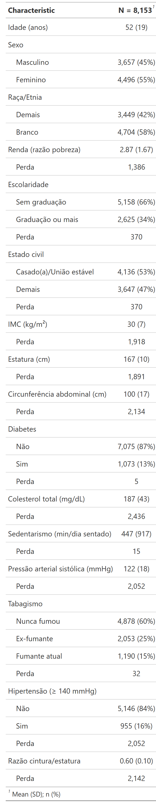

# Epidemiologia Computacional e Inteligência Artificial

Material de aula com pipeline completo de machine learning aplicado a dados populacionais reais — da limpeza dos dados à comparação de modelos preditivos — usando o ciclo **NHANES 2021–2023** como base.

---

## Objetivo

Desenvolver um modelo preditivo de **hipertensão arterial sistêmica** (pressão sistólica ≥ 140 mmHg) a partir de variáveis sociodemográficas e clínicas.

---

## Dados

Os dados são baixados automaticamente pelo pacote [`nhanesA`](https://cran.r-project.org/package=nhanesA) (NHANES, ciclo L — 2021–2023) e salvos localmente em `data/`.

| Tabela NHANES | Conteúdo |
|---|---|
| `DEMO_L` | Idade, sexo, raça/etnia, renda |
| `BMX_L` | Antropometria: cintura e estatura (para calcular razão cintura/estatura) |
| `BPXO_L` | Pressão arterial oscilométrica — PAS ≥ 140 mmHg = **desfecho** |
| `DIQ_L` | Diabetes diagnosticada |
| `TCHOL_L` | Colesterol total sérico |
| `SMQ_L` | Tabagismo (SMQ020 + SMQ040 → 3 categorias) |
| `PAQ_L` | Atividade física: sedentarismo (min/dia sentado) |

### Tabela descritiva dos dados



---

## Estrutura do Repositório

```
.
├── scripts/
│   ├── workflow.R                  # Executa todo o pipeline
│   ├── 00_setup.R                  # Download, limpeza e preparo dos dados
│   ├── 01_logistic_regression.R    # Regressão Logística
│   ├── 02_random_forest.R          # Árvore de Decisão + Random Forest
│   ├── 03_gradient_boosting.R      # Gradient Boosting (gbm / XGBoost)
│   ├── 04_neural_network.R         # Rede Neural (MLP via brulee)
│   ├── 05_exercicio.R              # Exercício: banco ampliado (~20 preditores)
├── data/                           # Dados NHANES em cache (.rds)
└── output/                         # Tabelas e gráficos
```

---

## Pipeline

Execute o pipeline completo a partir da raiz do projeto:

```r
source("scripts/workflow.R")
```

Ou rode cada etapa individualmente na ordem abaixo:

| # | Script | Modelo | Desfecho |
|---|---|---|---|
| 00 | `00_setup.R` | — | Download e limpeza dos dados |
| 01 | `01_logistic_regression.R` | Regressão Logística | HAS (PAS ≥ 140 mmHg) |
| 02 | `02_random_forest.R` | Árvore de Decisão + Random Forest | HAS (PAS ≥ 140 mmHg) |
| 03 | `03_gradient_boosting.R` | Gradient Boosting (stumps iterativos) | HAS (PAS ≥ 140 mmHg) |
| 04 | `04_neural_network.R` | Rede Neural MLP (`brulee`) | HAS (PAS ≥ 140 mmHg) |
| 05 | `05_exercicio.R` | — | Expande para ~20 preditores; rode 01–04 após |

---

## Conteúdo Didático por Script

- **`01` — Regressão Logística**: função logística, log-odds, odds ratio, curva ROC.
- **`02` — Árvore + Random Forest**: critério de Gini, overfitting (árvore rasa vs. profunda), importância de variáveis por redução de impureza (OOB).
- **`03` — Gradient Boosting**: conceito de *aprendiz fraco* (stump), learning rate, detecção do número ótimo de árvores via CV.
- **`04` — Rede Neural**: pré-processamento com `step_dummy` + `step_normalize`, arquitetura MLP, visualização de pesos.
- **`05` — Exercício**: baixa 9 tabelas adicionais (HbA1c, triglicerídeos, HDL, PCR, ácido úrico, creatinina, álcool, sono, PHQ-9) e reconstrói `dados`/`dados_treino`/`dados_teste` com ~20 preditores. Rode os scripts 01–04 novamente e compare os AUCs.

### Extras (`leftovers/`)
- **`dag.R`**: construção e visualização do DAG (directed acyclic graph) para o efeito causal do tabagismo sobre infarto.
- **`causal_inference.R`**: demonstração dos erros de supercontrole, ajuste correto pelo DAG e estimação por *Causal Forest* (`grf`).

---

## Dependências

```r
# Instala automaticamente via 00_setup.R
nhanesA, dplyr, forcats, gtsummary, tidymodels,
vip, rpart.plot, gbm, NeuralNetTools, ggplotify, brulee
```

> Para a rede neural (`brulee`), pode ser necessário instalar o backend PyTorch:
> ```r
> torch::install_torch()
> ```
